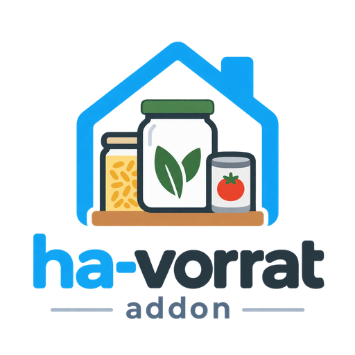

<p align="center">
  
</p>

# 🥫 Vorratsverwaltung – Home Assistant Add-on

[](https://paypal.me/jenser1)
[](https://github.com/jenser1/ha-vorrat-addon)
[](https://github.com/jenser1/ha-vorrat-addon/releases)
[](https://claude.com/claude-code)

Vollständige Haushalts-Vorratsverwaltung direkt in Home Assistant – mit Rezepten, Einkaufslisten, Web-Import und Dashboard-Sensoren.

> 🤖 **Mit KI erstellt:** Diese App wurde mit künstlicher Intelligenz (Anthropic Claude) über **[Claude Code](https://claude.com/claude-code)** entwickelt.

---

## ✨ Features

### 📦 Vorratsverwaltung
- Produkte mit Menge, Einheit, Lagerort und Kategorie verwalten
- **MHD-Warnungen** – farbcodiert (grün/gelb/rot/grau)
- **Mindestmengen** – automatische Warnung bei Unterschreitung
- Menge direkt per +/- Stepper anpassen
- **✏️ Bearbeiten an einem Platz**: Klick auf den Produktnamen öffnet die Produktseite – dort stehen alle Angaben in einem Formular (Name, Menge, Inhalt, Lagerort, Kategorie, MHD, Gebinde, Einfrieren/Einkochen, Bild, Nährwerte, Notiz) mit einem Speichern-Knopf; „Speichern & zur Übersicht" springt zurück zur Zeile des Produkts. Dazu „verwendet in Rezepten"
- **Bild & Nährwerte** per Foto-Upload oder automatisch über **Open Food Facts** (Namenssuche)
- **⚖️ Packungsinhalt**: optional „Inhalt pro Packung/Dose/Stück" (z. B. 500 g, 1 l) – die Übersicht zeigt dann „3 Packung · à 500 g · 1,5 kg"; Open Food Facts trägt den Inhalt automatisch ein
- **Angebrochen-Balken**: Füllstand der offenen Packung per Schieberegler (mit Packungsinhalt auch in Gramm, z. B. „noch 300 g") – unter 15 % wird automatisch 1 abgezogen
- **❄️ Einfrieren & 🥫 Einkochen**: Reste/Garten-Ernte konservieren – mit Behälter, Kennzeichnung (zum Wiedererkennen), Herkunft und automatischem „Verbrauchen bis"; Lagerorte als Gefrierfach markierbar

### 🛒 Einkaufslisten
- **Mehrere Listen** – z.B. Edeka, Aldi, Drogerie
- **Einzelpreis × Menge** = automatischer Gesamtpreis
- **Drag & Drop** Sortierung
- Erledigte Artikel automatisch in den Vorrat buchen
- Auto-Befüllung aus Produkten unter Mindestmenge

### 📖 Rezepte
- **Vorrat-Abgleich mit echten Mengen**: rechnet g ↔ kg, ml ↔ l und Packungen (über den Packungsinhalt) um, zählt alle Lagerorte zusammen und erkennt Schreibweisen (Zwiebel/Zwiebeln, Hackfleisch/Gehacktes, „Mehl (Type 405)")
  - ✅ genug da · ⚠️ zu wenig · 🛒 fehlt · ❓ unsicher (nur ähnlicher Name, z. B. Kokosmilch ↔ Milch) · ➖ nicht geprüft (Leitungswasser)
  - **🔗 Zuordnung merken**: Zutat einmal einem Vorratsprodukt zuordnen – gilt für alle Rezepte (oder „nicht prüfen", z. B. für Wasser)
  - „Fehlende Zutaten hinzufügen" schreibt die echte Fehlmenge auf die Einkaufsliste – bei Packungsware als ganze Packungen
- **PDF-Import** mit automatischer Spalten-Erkennung
- **Web-Import** von Chefkoch, Kaufland, Lidl und hunderten weiteren Seiten
- **📋 Text-Import**: Rezept aus freiem Text einfügen (Instagram-/Facebook-Bildunterschrift, WhatsApp, Koch-App) – wird automatisch in Zutaten & Schritte zerlegt, editierbare Vorschau
- **👨‍🍳 Kochmodus**: Vollbild-Ansicht Schritt für Schritt beim Kochen – große Schrift, Fortschrittsbalken, einblendbare Zutaten, Bildschirm bleibt an (Wake Lock)
- **⏱️ Zeitangaben**: Vorbereitungs-, Koch-/Back- und Gesamtzeit – beim Web-/Text-Import automatisch übernommen, auf der Rezeptseite und im Kochmodus angezeigt
- Filter und Sortierung nach Kategorie

### ⏲️ Küchen-Timer
- **Überall startbar**: ⏲️-Knopf unten rechts auf jeder Seite – Presets (5–60 Min) oder freie Minuten
- **Im Kochmodus** zusätzlich Schnellwahl aus den Rezeptzeiten (Vorbereitung / Kochen / Gesamt)
- **Läuft im Add-on**, nicht im Browser: Seite wechseln oder Tab schließen – der Timer läuft weiter
- Beim Ablauf: Piepton/Vibration im Browser **und** Meldung an Home Assistant → Event `vorrat_kochtimer_fertig` + `sensor.vorrat_kochtimer`
- Optional **direkte Handy-Push** (notify-Dienst in den Einstellungen wählbar) – oder eigene Automation (Klingeln, Sprachansage, Wecker, …), siehe unten

### 📅 Essensplaner
- Wochenansicht mit **Frühstück / Mittag / Abend**
- Pro Mahlzeit: vorhandenes Rezept **oder** eigener Freitext
- **Personenzahl** pro Mahlzeit + fehlende Zutaten direkt zur Einkaufsliste
- **„Zum Essensplan"** direkt von jeder Rezeptseite
- **Anbindung an den Home-Assistant-Kalender** (Zwei-Wege-Sync)
- Im HA-Kalender gelöschte Mahlzeiten verschwinden auch aus dem Planer

### 📊 Dashboard-Sensoren
Automatisch verfügbare HA-Sensoren:
| Sensor | Beschreibung |
|--------|-------------|
| `sensor.vorrat_abgelaufen` | Anzahl abgelaufener Produkte |
| `sensor.vorrat_bald_ablaufend` | Ablaufend in ≤7 Tagen |
| `sensor.vorrat_kritisch` | Ablaufend in ≤3 Tagen |
| `sensor.vorrat_unter_mindestmenge` | Unter Mindestmenge |
| `sensor.vorrat_gesamt` | Gesamtanzahl Produkte |
| `sensor.vorrat_einkaufsliste` | Offene Artikel in Einkaufslisten |
| `sensor.vorrat_tiefkuehl` | Anzahl eingefrorener Produkte |
| `sensor.vorrat_eingekocht` | Anzahl eingekochter Produkte |
| `sensor.vorrat_kochtimer` | Küchen-Timer: `idle` / `läuft` / `fertig` (Attribute: Label, Rezept, Restzeit) |

### 🌍 Mehrsprachig & Mehrere Währungen
- Sprachen: Deutsch, Englisch, Französisch, Spanisch
- Währungen: € Euro, CHF Franken, £ Pfund, $ Dollar

### 📱 Mobil-optimiert
- Läuft auf dem Handy direkt in der **Home-Assistant-App** (Android & iPhone) – keine zusätzliche App, kein eigenes Konto (Anleitung unten: **„📱 Auf dem Handy"**)
- Bottom-Navigation für einfache Bedienung auf dem Handy
- Große Touch-Flächen, kein versehentlicher Zoom

---

## 🔧 Installation

### Über den App-Store von Home Assistant (empfohlen)
1. **Einstellungen → Apps → App-Store** → ⋮ (oben rechts) → **Repositories**
   <br><sub>Bis Home Assistant 2026.1 hießen Apps noch „Add-ons": *Einstellungen → Add-ons → Add-on Store → ⋮ → Repositories*</sub>
2. URL hinzufügen: `https://github.com/jenser1/ha-vorrat-addon`
3. **Vorratsverwaltung** installieren & starten
4. Auf der Info-Seite **„In der Seitenleiste anzeigen"** einschalten – dann steht die Vorratsverwaltung links in der Seitenleiste von Home Assistant, **im Browser und in der Home-Assistant-App auf dem Handy** – auch für Benutzer **ohne Admin-Rechte** (z. B. die ganze Familie)


---

## 📊 Dashboard einbinden

Beispiel-Karte – ergänze weitere Sensoren aus der Sensor-Tabelle oben nach Bedarf:

```yaml
type: entities
title: 🥫 Vorratsverwaltung
entities:
  - sensor.vorrat_abgelaufen
  - sensor.vorrat_bald_ablaufend
  - sensor.vorrat_einkaufsliste
  # … weitere Sensoren aus der Tabelle oben
```

---

## ⏲️ Küchen-Timer → Home Assistant

Läuft ein Timer ab, meldet das Add-on das an Home Assistant – auf **jeder** Installation gleich:
- **Event** `vorrat_kochtimer_fertig` (Daten: `label`, `rezept`, `sekunden`)
- **Sensor** `sensor.vorrat_kochtimer`: `idle` → `läuft` → `fertig` (bleibt 10 Min) → `idle`

**Einstellungen → „⏲️ Küchen-Timer → Home Assistant":** Handy für die direkte Push wählen (die Liste kommt aus deinem eigenen HA), Nachrichtentext mit `{label}`, `{rezept}`, `{zeit}` anpassen – und mit **🔔 Test senden** alles sofort auslösen, ohne auf einen Timer zu warten.

> 💡 Das Event taucht in HA in keiner Liste auf (Events existieren nur im Moment des Feuerns). Einfacher: den **Sensor** als Auslöser nehmen – der ist im Automations-Editor auswählbar.

### Beispiel 1: Handy laut klingeln lassen
Durchbricht Lautlos / „Nicht stören" – Android über den Wecker-Kanal, iPhone als kritische Mitteilung (einmalig in der App erlauben). Beides in einer Automation; jedes Handy nimmt sich, was es versteht:

```yaml
alias: ⏲️ Kochtimer – Handy klingeln lassen
mode: single
triggers:
  - trigger: state
    entity_id: sensor.vorrat_kochtimer
    to: fertig
actions:
  - action: notify.mobile_app_DEIN_HANDY
    data:
      title: "⏲️ Kochtimer fertig!"
      message: "{{ state_attr('sensor.vorrat_kochtimer', 'label') or 'Timer' }} ist abgelaufen"
      data:
        ttl: 0
        priority: high
        channel: alarm_stream        # Android: Wecker-Kanal
        importance: high
        sticky: true
        tag: kochtimer
        push:                        # iPhone: kritische Mitteilung
          sound:
            name: default
            critical: 1
            volume: 1.0
```
Tipp Android: *Android-Einstellungen (am Handy) → Apps → Home Assistant → Benachrichtigungen → alarm_stream* → einen Klingelton wählen, dann klingelt es wie ein Wecker. Nutzt du diese Automation, die direkte Push im Add-on auf „keine" stellen (sonst kommen zwei Nachrichten).

### Beispiel 2: Sprachansage auf einem Lautsprecher
```yaml
alias: ⏲️ Kochtimer – Ansage
triggers:
  - trigger: state
    entity_id: sensor.vorrat_kochtimer
    to: fertig
actions:
  - action: tts.speak
    target:
      entity_id: tts.DEINE_TTS_ENGINE
    data:
      media_player_entity_id: media_player.DEIN_LAUTSPRECHER
      message: "Der Kochtimer {{ state_attr('sensor.vorrat_kochtimer', 'label') }} ist fertig."
```

---

## 📱 Auf dem Handy – über die Home-Assistant-App

Die Vorratsverwaltung ist **keine eigene Handy-App**: Sie läuft *in* Home Assistant. Auf dem Handy öffnest du sie in der offiziellen, kostenlosen **Home-Assistant-App** (Companion-App) – genau wie dein Dashboard.

### Einrichten (einmalig)
1. Home-Assistant-App installieren – [Android (Google Play)](https://play.google.com/store/apps/details?id=io.homeassistant.companion.android) · [iPhone/iPad (App Store)](https://apps.apple.com/app/id1099568401) – und mit deinem Home Assistant verbinden.
2. In Home Assistant: **Einstellungen → Apps → Vorratsverwaltung → Info** → **„In der Seitenleiste anzeigen"** einschalten.
3. In der App die **Seitenleiste** öffnen (☰ oben links oder vom linken Rand wischen) → **Vorratsverwaltung** antippen.

### Gut zu wissen
- 🔐 **Anmeldung:** dein normales Home-Assistant-Konto – kein extra Passwort. Die Daten bleiben bei dir in Home Assistant.
- 🏠 **Zuhause** im WLAN klappt es sofort. 🌍 **Unterwegs** (z. B. im Supermarkt mit der Einkaufsliste) nur, wenn deine Home-Assistant-App auch von außen verbunden ist – z. B. über *Home Assistant Cloud (Nabu Casa)* oder eine eigene externe Adresse. Für die Vorratsverwaltung selbst muss **kein Port** freigegeben werden: Sie läuft geschützt über Home Assistant (Ingress).
- 🔔 Die Nachrichten des **Küchen-Timers** kommen ebenfalls über die Home-Assistant-App (siehe Abschnitt *„⏲️ Küchen-Timer → Home Assistant"*).
- 👨‍🍳 **Kochmodus – Bildschirm anlassen:** Auf Android in der App unter **Einstellungen → Companion-App** (weiter unten) die Option *„Keep screen on"* (Bildschirm eingeschaltet lassen) aktivieren – dann geht das Display nicht aus, solange die App offen ist. Die eingebaute „Bildschirm bleibt an"-Funktion des Kochmodus braucht dagegen eine HTTPS-Verbindung (z. B. Nabu Casa) und klappt nicht auf jedem Handy.

### Tipp: eigenes Symbol auf dem Startbildschirm
Damit sich die Vorratsverwaltung mit einem Tipp **direkt** öffnet, ohne Umweg über die Seitenleiste:

1. **Pfad herausfinden:** Home Assistant am PC im Browser öffnen, links auf **Vorratsverwaltung** klicken und in der Adresszeile den Teil **nach** der Portnummer bzw. Domain abschreiben – z. B. `/a1b2c3d4_vorratsverwaltung`. Die Zeichen vor `_vorratsverwaltung` sind bei jeder Installation anders, also bitte deinen eigenen Pfad nehmen.
2. **Android** (ab Android 8): Home-Assistant-App → **Einstellungen → Companion-App → Verknüpfungen** (engl. *Manage Shortcuts*) → neue Verknüpfung anlegen: Name z. B. „Vorrat", Typ **Dashboard**, als **Pfad** deinen Pfad von oben (z. B. `/a1b2c3d4_vorratsverwaltung`) → auf dem **Startbildschirm ablegen**.
3. **iPhone/iPad:** App **Kurzbefehle** → **+** → Aktion **„URL öffnen"** mit `homeassistant://navigate/a1b2c3d4_vorratsverwaltung` (deinen Pfad ohne den ersten `/` einsetzen) → Teilen-Symbol → **„Zum Home-Bildschirm"**.

### Ohne App
Geht auch im **Handy-Browser**: Home Assistant öffnen (gleiche Adresse wie am PC) → Seitenleiste → **Vorratsverwaltung**. Bequemer und mit Push-Nachrichten ist aber die Home-Assistant-App.

---

## 💾 Speicherbedarf & Datenverbrauch

Datensparsam und komplett **lokal** – kein Konto, keine Cloud, keine Telemetrie.

**Wo liegen die Daten?** Alles im HA-Ordner `/share/vorratsverwaltung/`: `vorrat.db` (SQLite-Datenbank), `bilder/` (Produktfotos) und `.secret_key`. Dadurch bleiben die Daten bei Add-on-Updates erhalten und sind in HA-Backups enthalten.

| Größe / Ressource | Wert |
|---|---|
| Add-on-Image (Download bei Installation) | ca. 150–250 MB \* (Python-Alpine + Bibliotheken) |
| Arbeitsspeicher im Betrieb | ~60–70 MB |
| Datenbank | wenige MB – ein Eintrag ist nur ein paar hundert Byte (1000 Produkte ≈ 1 MB) |
| Produktfotos | je Bild max. 5 MB (nur wenn du Fotos hinterlegst) |
| Quellcode | ~0,4 MB |

<sub>\* grobe Schätzung; das Image wird einmalig beim Installieren/Update geladen.</sub>

**Internet-Datenverkehr:** im Normalbetrieb praktisch **null**. Sensor-Updates (alle 5 Min) und Kalender-Sync laufen nur über die **lokale** HA-API. Internet nur bei aktiver Nutzung von **Web-Import** (~100–300 KB je Rezept) oder **Open Food Facts** (kleine JSON-Antwort + optional 1 Bild, max. 5 MB).

---

## 🤝 Mitmachen & Feedback

Hast du einen Fehler gefunden oder eine Idee für ein neues Feature?

👉 **[Issue erstellen](https://github.com/jenser1/ha-vorrat-addon/issues/new)** – ich freue mich über jedes Feedback!

**Bitte beschreibe bei Bugs:**
- Was hast du gemacht?
- Was ist passiert?
- Was hast du erwartet?
- Home Assistant Version & Hardware (z.B. Raspberry Pi 4)

**Ideen & Feature-Wünsche** sind ebenfalls willkommen – einfach als Issue mit dem Label `enhancement` eintragen.

👤 **Maintainer:** Jens ([@jenser1](https://github.com/jenser1))

---

## 📝 Changelog

Hier stehen die **aktuelle und die vorherige Version**. Alle älteren Versionen – und was für die nächste
Version schon fertig ist – stehen in der **[CHANGELOG.md](CHANGELOG.md)**.
Home Assistant zeigt beim Update der App automatisch die neuen Einträge an.

### 1.8.1 – aktuelle Version

#### 🍳 „Gekocht“ – Zutaten aus dem Vorrat abbuchen
- Neuer Knopf **„🍳 Gekocht“** auf der Rezeptseite: Ein Dialog fragt die Portionen ab und zeigt vorab, was aus welchem Produkt abgebucht wird. Einzelne Zutaten lassen sich abwählen (z. B. wenn du ein anderes Öl genommen hast)
- Abgebucht wird mit demselben Abgleich wie auf der Rezeptseite (g ↔ kg, ml ↔ l, Packung über den Packungsinhalt, gemerkte 🔗-Zuordnungen)
- Packungsware bleibt ganz: 250 g aus „3 Packung à 1 kg“ ergibt **2 Packung + 1 angebrochene (75 %)**. Zuerst wird die angebrochene Packung verbraucht, dann die mit dem frühesten MHD
- Zu wenig da → alles Vorhandene wird abgebucht, der Rest gilt als fehlend
- Fehlt etwas oder ist es nur ähnlich (❓), wird nichts abgebucht. Danach kannst du die fehlenden Zutaten gezielt **auf die Einkaufsliste setzen** – nichts passiert automatisch
- Nicht umrechenbare Einheiten (z. B. 400 g ↔ Dose ohne Inhalt) erscheinen unter **„Manuell prüfen“**, mit Tipp zum Packungsinhalt. Prise, Msp. und Leitungswasser werden nie abgebucht
- **↩️ Rückgängig** direkt in der Ergebniskarte. Produkte, die du inzwischen geändert hast, bleiben dabei unangetastet
- Am Rezept: **„🍳 3× gekocht · zuletzt vor 5 Tagen“** – auch auf den Rezeptkarten, dazu die neue Sortierung **„Zuletzt gekocht“**
- Auch am Ende des **Kochmodus** und im **Essensplaner** (🍳 am geplanten Rezept, mit dessen Personenzahl)

#### ⚖️ Löffelmaße
- **EL/TL** werden jetzt umgerechnet (1 EL ≈ 15 ml bzw. 15 g, 1 TL ≈ 5 ml bzw. 5 g), je nachdem, ob das Produkt in ml oder g geführt wird. „2 EL Öl“ zeigt also z. B. „Öl: 750 ml da“ statt nur „vorhanden“. Gilt für Rezeptseite, Einkaufsliste und Abbuchen
- „Esslöffel“/„Teelöffel“ werden als EL/TL erkannt

#### 📱 Kleinigkeiten
- Die Vorratsverwaltung erscheint jetzt auch bei Benutzern **ohne Admin-Rechte** in der Seitenleiste (`panel_admin: false`) – z. B. für die ganze Familie
- Rezeptseite auf dem Handy: Die Knöpfe oben zeigen nur noch das Symbol, damit die Leiste nicht über den Rand läuft
- README zeigt die Änderungen der **aktuellen und der vorherigen Version** direkt an, ältere stehen weiter in der CHANGELOG.md

#### 🛠️ Entwicklung
- Neu: **CLAUDE.md** – Anleitung für die Weiterentwicklung mit Claude Code (Befehle, Testmuster, Architektur, Release-Ablauf)
- Persönliche Angaben gehören in eine eigene `CLAUDE.local.md`; sie ist per `.gitignore` ausgeschlossen und wird nie hochgeladen

💾 Die Datenbank wird beim Start automatisch ergänzt (Koch-Zähler und „zuletzt gekocht“) – vorhandene Daten bleiben unverändert.

### 1.8.0 – vorherige Version

#### ⚖️ Packungsinhalt
- Neues Feld **„Inhalt pro Packung/Dose/Stück"** (z. B. 500 g, 1 l) – freiwillig
- Übersicht zeigt z. B. **„3 Packung · à 500 g · 1,5 kg"**, bei angebrochenen Packungen zusätzlich **„1 offen: noch 700 g"**
- Der „Angebrochen"-Regler zeigt den Rest auch in Gramm bzw. ml
- Open Food Facts trägt den Packungsinhalt automatisch ein und zeigt die Packungsgröße schon in den Suchtreffern

#### 🍳 Rezept-Abgleich mit echten Mengen
- Rechnet g ↔ kg, ml ↔ l und Packungen (über den Packungsinhalt) um und zählt alle Lagerorte eines Produkts zusammen
- Erkennt Schreibweisen: Zwiebel/Zwiebeln, Hackfleisch/Gehacktes, „Mehl (Type 405)", Weizenmehl → Mehl
- Status je Zutat: ✅ genug da · ⚠️ zu wenig · 🛒 fehlt · ❓ unsicher (nur ähnlicher Name, z. B. Kokosmilch ↔ Milch) · ➖ nicht geprüft (z. B. Leitungswasser)
- **🔗 Zuordnung merken**: eine Zutat einmal einem Vorratsprodukt zuordnen – gilt dann für alle Rezepte (oder „nicht prüfen")
- Braucht ein Rezept dasselbe Produkt mehrmals (z. B. Butter für Teig und Füllung), wird der Bedarf zusammengezählt
- „Fehlende Zutaten hinzufügen" – auch im Essensplaner – schreibt die echte Fehlmenge auf die Einkaufsliste, bei Packungsware als ganze Packungen
- „Verwendet in Rezepten" auf der Produktseite nutzt denselben Abgleich

#### ✏️ Bearbeiten an einem Platz
- Klick auf den Produktnamen öffnet die Produktseite – dort stehen **alle Angaben in einem Formular** (Name, Menge, Inhalt, Lagerort, Kategorie, MHD, Gebinde, Einfrieren/Einkochen, Bild, Nährwerte, Notiz) mit einem Speichern-Knopf
- **„Speichern & zur Übersicht"** springt zurück zur Zeile des Produkts – mit dem vorher gewählten Filter
- Rückfrage, bevor ungespeicherte Änderungen verloren gehen
- Der ✏️-Knopf in der Übersicht und die getrennten Formulare (Bild/Nährwerte/Notiz, Tiefkühl-Karte) entfallen

#### 📱 Handy & Kleinigkeiten
- Rezeptseite auf Handy/Tablet untereinander – die Zutatenliste wird nicht mehr abgeschnitten
- Kopfleiste der Produktseite am Handy kompakt (nur Symbole)
- Mengen mit mehreren Nachkommastellen (z. B. 2,75) lassen sich speichern; eine frei eingetragene Herkunft bleibt beim Speichern erhalten
- README: Nutzung über die **Home-Assistant-App** genau beschrieben, Menüpfade für Home Assistant 2026.2 („Apps" statt „Add-ons") aktualisiert
- Neu: die **CHANGELOG.md** – Home Assistant zeigt sie beim Update an
- Security-Policy auf 1.8.x aktualisiert

💾 Die Datenbank wird beim Start automatisch ergänzt (Packungsinhalt und Zutaten-Zuordnungen) – vorhandene Daten bleiben unverändert.
